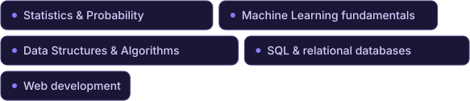
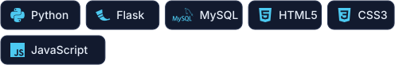

  

## About

I'm a B.Tech undergraduate interested in software development, data science and AI/ML. I like building applications that solve a concrete problem, and my projects so far have given me hands-on experience with Python, SQL, data analysis and web technologies.

Alongside my coursework, I'm working on algorithms, statistics, databases and software design. I learn best by implementing an idea, testing it against real data, and improving it over several iterations.

## Currently Learning & Exploring

## Featured Projects

<table>
  <tr>
    <td>
      <h3><a href="https://github.com/Priyanshu-172969/ScoreSense">ScoreSense</a> | IPL Data Analytics Dashboard</h3>
      
An interactive IPL analytics dashboard exploring historical cricket data, team and player performance, seasonal trends and match statistics through data-driven visualizations.

      <ul>
        <li>Data cleaning and exploratory analysis with Python and Pandas on 1,100+ matches and 260,000+ ball-by-ball records</li>
        <li>Interactive Plotly charts for team and player analysis</li>
        <li>Multi-view Streamlit dashboard with Home, Team Analysis and Player Analysis sections</li>
        <li>Publicly accessible live demo on Streamlit Community Cloud</li>
      </ul>
      

      
<a href="https://scoresense-5kzo4sywq2ahzxwoxjqcfh.streamlit.app/">Live demo</a> &nbsp;|&nbsp; <a href="https://github.com/Priyanshu-172969/ScoreSense">Source code</a>

    </td>
  </tr>
  <tr>
    <td>
      <h3><a href="https://github.com/Priyanshu-172969/YatraSetu-Website">YatraSetu</a> | Indian Heritage Explorer &amp; Trip Planner</h3>
      
Status: near completion. Runs locally and is not yet deployed.

      
An Indian heritage exploration and trip-planning application that brings together destination discovery, estimated travel budgets and multi-stop itinerary management through a Flask and MySQL web platform.

      <ul>
        <li>Database: five normalized MySQL tables with primary and foreign keys and cascade and restrict rules</li>
        <li>SQL: joins, aggregates, GROUP BY, HAVING and subqueries across the reports page and a documented query set</li>
        <li>Backend: Flask with parameterized queries, CSRF protection, server-side validation and full CRUD for destinations and trip plans</li>
        <li>Data: 30 destinations and 90 budget estimates from Bengaluru, Kolkata and New Delhi, loaded through a validating CSV importer</li>
        <li>Automated unit test suite</li>
      </ul>
      

      
<a href="https://github.com/Priyanshu-172969/YatraSetu-Website">Source code</a>

    </td>
  </tr>
</table>

## Technology Stack

<table>
  <tr>
    <td><b>Programming Languages and Querying</b></td>
    <td></td>
  </tr>
  <tr>
    <td><b>Web Development</b></td>
    <td></td>
  </tr>
  <tr>
    <td><b>Databases</b></td>
    <td></td>
  </tr>
  <tr>
    <td><b>Data Analytics and Visualization</b></td>
    <td></td>
  </tr>
  <tr>
    <td><b>Development Tools</b></td>
    <td></td>
  </tr>
</table>

## GitHub Activity

<picture>
  <source media="(prefers-color-scheme: dark)" srcset="https://raw.githubusercontent.com/Priyanshu-172969/Priyanshu-172969/output/github-snake-dark.svg">
  <source media="(prefers-color-scheme: light)" srcset="https://raw.githubusercontent.com/Priyanshu-172969/Priyanshu-172969/output/github-snake.svg">
  
</picture>

## Connect With Me

Open to feedback and to collaborating on software, data and machine learning projects. Email is the quickest way to reach me: [priyanshubid3@gmail.com](mailto:priyanshubid3@gmail.com).
