<!-- ═══════════════════════════════════════════════════════════════════════════
     🚀 Priyanshu Kr Bid — GitHub Profile README
     ═══════════════════════════════════════════════════════════════════════════ -->

<div align="center">
  <picture>
    <source media="(max-width: 600px)" srcset="assets/profile-banner-mobile.svg">
    
  </picture>
</div>

<p align="center">
    
</p>

<p align="center">
  <a href="#-about-me">About</a> &nbsp;·&nbsp;
  <a href="#-featured-projects">Projects</a> &nbsp;·&nbsp;
  <a href="#-technology-stack">Tech Stack</a> &nbsp;·&nbsp;
  <a href="#-certifications">Certifications</a> &nbsp;·&nbsp;
  <a href="#-connect-with-me">Connect</a>
</p>

<p align="center">
    
    &nbsp;
    <a href="https://github.com/Priyanshu-172969?tab=followers">
        
    </a>
    &nbsp;
    <a href="https://github.com/Priyanshu-172969?tab=repositories&sort=stargazers">
        
    </a>
</p>

---

<div align="center">
  <picture>
    <source media="(max-width: 600px)" srcset="assets/terminal-mobile.svg">
    
  </picture>
</div>

---

## 🧑‍💻 About Me


```yaml
name:       Priyanshu Kr Bid
college:    National Institute of Technology, Durgapur
location:   Durgapur, West Bengal, India 🇮🇳
degree:     B.Tech Biotechnology (Second Year)

interests:
  - Data-driven problem solving
  - Biotech × AI intersection
  - Building practical software tools
```

<br clear="right"/>

> *"I like turning structured information into practical tools and learning how useful applications fit together."*

---

## 🏆 GitHub Trophies

<p align="center">
    
</p>

---

## 🚀 Featured Projects

<table>
  <tr>
    <td width="50%" valign="top">
      <h3 align="center">🏏 ScoreSense</h3>
      <p align="center"><strong>IPL Data Analytics Dashboard</strong></p>
      <p align="center">
        <a href="https://scoresense-5kzo4sywq2ahzxwoxjqcfh.streamlit.app/">
          
        </a>
        &nbsp;
        <a href="https://github.com/Priyanshu-172969/ScoreSense">
          
        </a>
      </p>
      <p>
        An IPL data analysis project dissecting historical match data to uncover performance patterns.
      </p>
      <ul>
        <li>Cleaned and explored match-level and ball-by-ball data with <strong>Python</strong> & <strong>Pandas</strong></li>
        <li>Built interactive <strong>Plotly</strong> charts for team and player performance metrics</li>
        <li>Deployed as a sleek <strong>Streamlit</strong> web application</li>
      </ul>
      <p align="center">
        
        
        
        
      </p>
    </td>
    <td width="50%" valign="top">
      <h3 align="center">🕌 YatraSetu</h3>
      <p align="center"><strong>Indian Heritage Explorer & Trip Planner</strong></p>
      <p align="center">
        
        &nbsp;
        <a href="https://github.com/Priyanshu-172969/YatraSetu-Website">
          
        </a>
      </p>
      <p>
        A platform for discovering India's heritage destinations and planning budget-friendly trips.
      </p>
      <ul>
        <li>Five-table relational schema to manage destinations & trip plans</li>
        <li>Complex <strong>SQL</strong> reporting with joins, aggregates & subqueries</li>
        <li>Itemised budget estimates from Bengaluru, Kolkata & New Delhi</li>
      </ul>
      <p align="center">
        
        
        
        
        
        
      </p>
    </td>
  </tr>
</table>

---

## 🛠️ Technology Stack

<table align="center">
  <tr>
    <td align="center" width="140"><strong>Languages</strong></td>
    <td>
      
      
      
      
      
    </td>
  </tr>
  <tr>
    <td align="center"><strong>Web</strong></td>
    <td>
      
      
      
      
    </td>
  </tr>
  <tr>
    <td align="center"><strong>Data & ML</strong></td>
    <td>
      
      
      
    </td>
  </tr>
  <tr>
    <td align="center"><strong>Databases</strong></td>
    <td>
      
    </td>
  </tr>
  <tr>
    <td align="center"><strong>Tools & Platforms</strong></td>
    <td>
      
      
      
      
    </td>
  </tr>
  <tr>
    <td align="center"><strong>AI Tools</strong></td>
    <td>
      
      
    </td>
  </tr>
</table>

---

## 🎓 Certifications

<p align="center">
    
    &nbsp;
    
    &nbsp;
    
</p>

---

## 📊 GitHub Analytics

<p align="center">
    
</p>

<p align="center">
    
</p>

<p align="center">
    
    &nbsp;
    
    &nbsp;
    
</p>

<p align="center">
    
    &nbsp;
    
</p>

---

## 🐍 Contribution Snake

<p align="center">
  <picture>
    <source media="(prefers-color-scheme: dark)" srcset="https://raw.githubusercontent.com/Priyanshu-172969/Priyanshu-172969/output/github-snake-dark.svg">
    <source media="(prefers-color-scheme: light)" srcset="https://raw.githubusercontent.com/Priyanshu-172969/Priyanshu-172969/output/github-snake.svg">
    
  </picture>
</p>

---

## 🌐 Connect With Me

<p align="center">
    <a href="mailto:priyanshubid3@gmail.com">
        
    </a>
    &nbsp;
    <a href="https://www.linkedin.com/in/priyanshu-bid-5b6140366/">
        
    </a>
    &nbsp;
    <a href="https://instagram.com/priyanshu____1729">
        
    </a>
    &nbsp;
    <a href="https://github.com/Priyanshu-172969">
        
    </a>
</p>

---

<div align="center">
  
</div>

<br/>

<p align="center">
  <em>Open to learning, sharing ideas, and collaborating on software and data projects.</em>
</p>

<p align="center">
  
</p>
