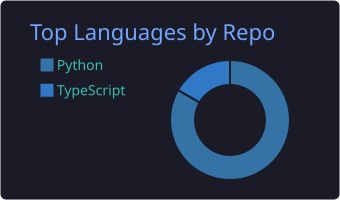

  <picture>
    <source media="(max-width: 600px)" srcset="assets/profile-banner-mobile.svg">
    
  </picture>

  <a href="#about-me">About</a> &nbsp;·&nbsp;
  <a href="#featured-projects">Projects</a> &nbsp;·&nbsp;
  <a href="#technology-stack">Stack</a> &nbsp;·&nbsp;
  <a href="#connect-with-me">Connect</a>

  <picture>
    <source media="(max-width: 600px)" srcset="assets/terminal-mobile.svg">
    
  </picture>

## About Me

I’m an undergraduate building foundations in software development, data science, and AI/ML. I like turning structured information into practical tools and learning how useful applications fit together.

## Featured Projects

<table>
  <tr>
    <td width="48%" align="center" valign="middle">
      
    </td>
    <td width="52%" valign="top">
      <h3>ScoreSense · IPL Data Analytics Dashboard</h3>
      
      
An IPL data analysis project focused on historical match data.

      <ul>
        <li>Cleaned and explored match-level and ball-by-ball data with Python and Pandas.</li>
        <li>Built interactive Plotly charts for team and player performance.</li>
        <li>Presented the analysis through a Streamlit application.</li>
      </ul>
      

      
    </td>
  </tr>
</table>

<table>
  <tr>
    <td colspan="2">
      <h3>YatraSetu · Indian Heritage Explorer &amp; Trip Planner</h3>
      
      
An Indian heritage explorer and trip planner built with Flask and MySQL.

      <ul>
        <li>Uses a five-table relational schema to manage destinations and trip plans.</li>
        <li>Supports SQL reporting with joins, aggregates, grouping, and subqueries.</li>
        <li>Includes itemised budget estimates for trips from Bengaluru, Kolkata, and New Delhi.</li>
      </ul>
      

      
    </td>
  </tr>
</table>

## Technology Stack

  <picture>
    <source media="(max-width: 600px)" srcset="assets/stack/technology-stack-mobile.svg">
    
  </picture>
  
Also know: C, C++

## GitHub Activity

  <picture>
    <source media="(prefers-color-scheme: dark)" srcset="https://raw.githubusercontent.com/Priyanshu-172969/Priyanshu-172969/output/github-snake-dark.svg">
    <source media="(prefers-color-scheme: light)" srcset="https://raw.githubusercontent.com/Priyanshu-172969/Priyanshu-172969/output/github-snake.svg">
    
  </picture>
  

## Connect With Me

  
  &nbsp;
  
  &nbsp;
  

Open to learning, sharing ideas, and collaborating on software and data projects.

